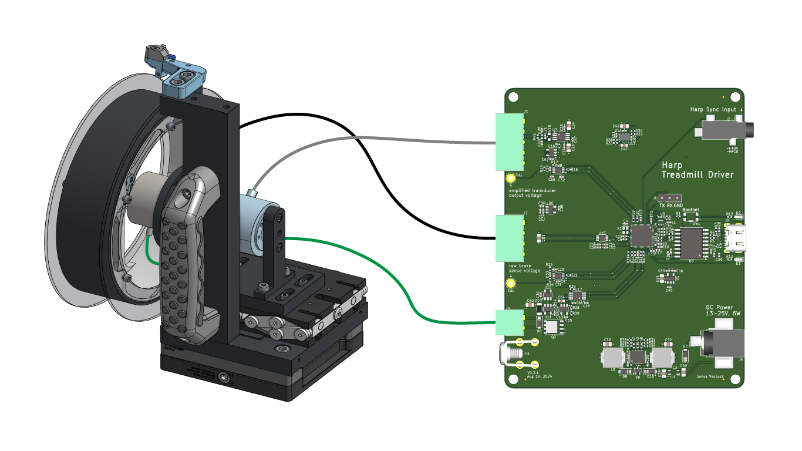

A Harp Device for controlling an instrumented variable-friction mouse treadmill

> [!NOTE]
> This repository contains design files for the electronics assembly. For the mechanical assembly, design files, and bill-of-materials, see the [OnShape project](https://cad.onshape.com/documents/579ff6de692121d8b6a45604/v/23e1e086e9eb645d096dac80/e/a0ad881c32324c0acf8e15df).

> [!IMPORTANT]
> This version runs on a Raspberry Pi Pico that slots into a carrier board with an encoder input plug and a Harp Sync plug.
> The magnetic brake and torque sensor are **disabled**.
> Their registers are kept so that existing software for the treadmill-driver keeps working: torque and brake current read as 0, and brake and torque-limit settings are accepted but have no effect.

## Features
* runs on a Raspberry Pi Pico mounted on a carrier board.
* quadrature encoder input for position/speed measurements, with logic-level shifting.
* Harp-protocol compliant over full-speed USB.
* accepts Harp time synchronization input.
* register-compatible with the original treadmill-driver (WhoAmI 1402).

## Register Map
[List of Registers](./firmware/docs/register_map.csv)

## Credits
The original board design was created in partnership with the team at [Second Order Effects](https://soeffects.com/).
